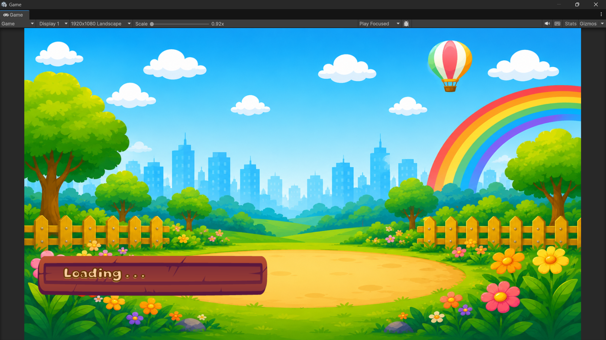
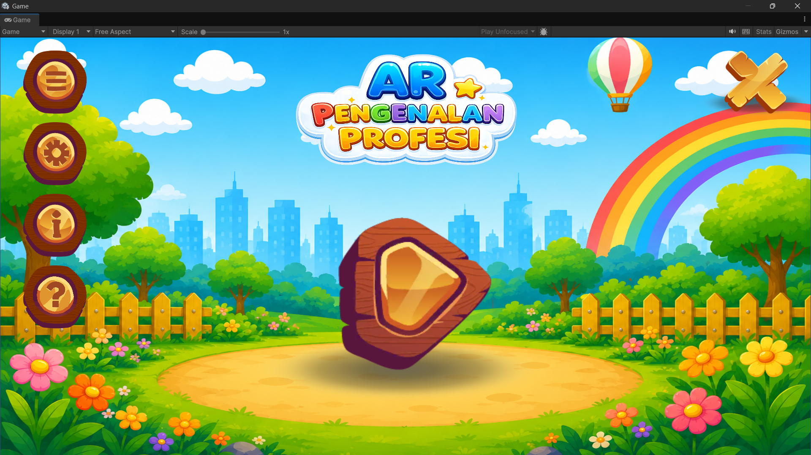
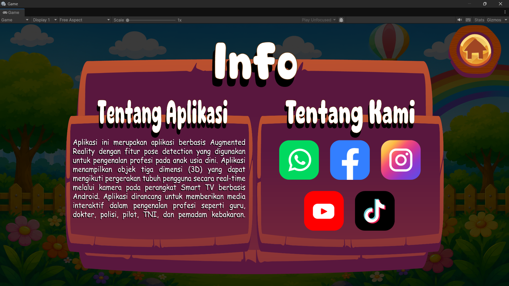
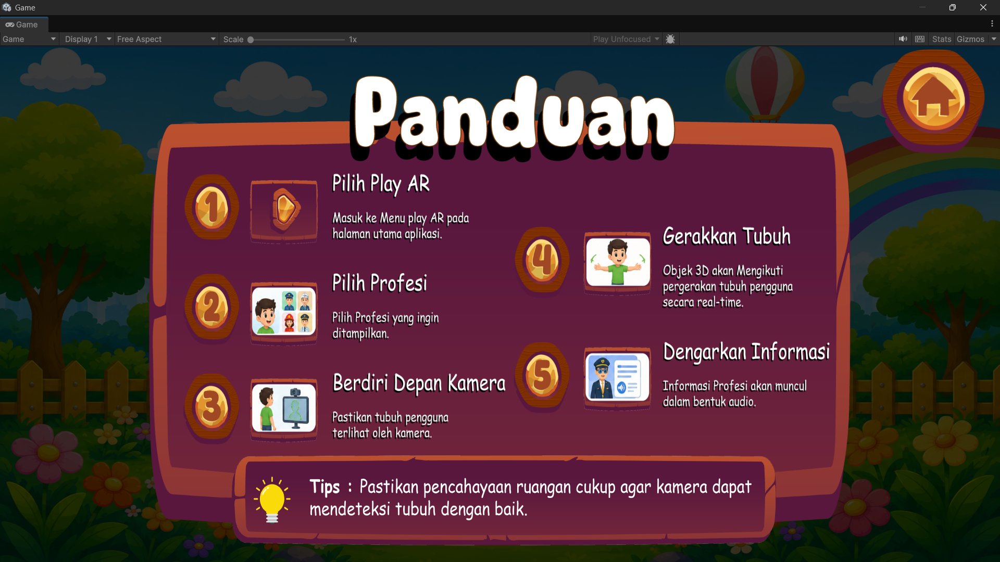
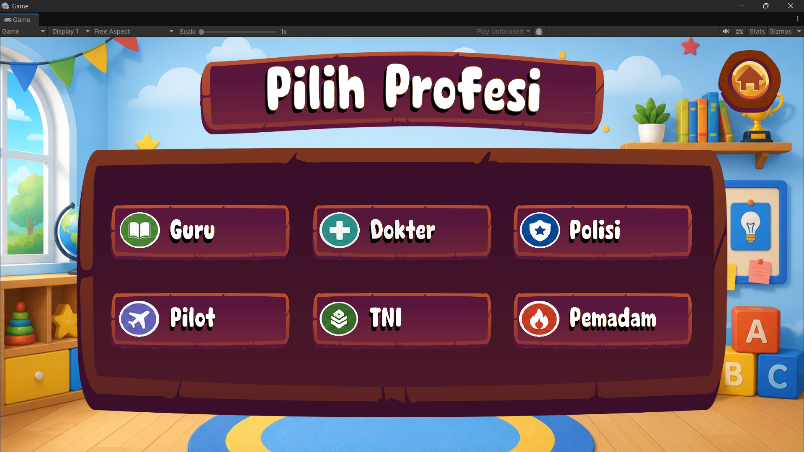
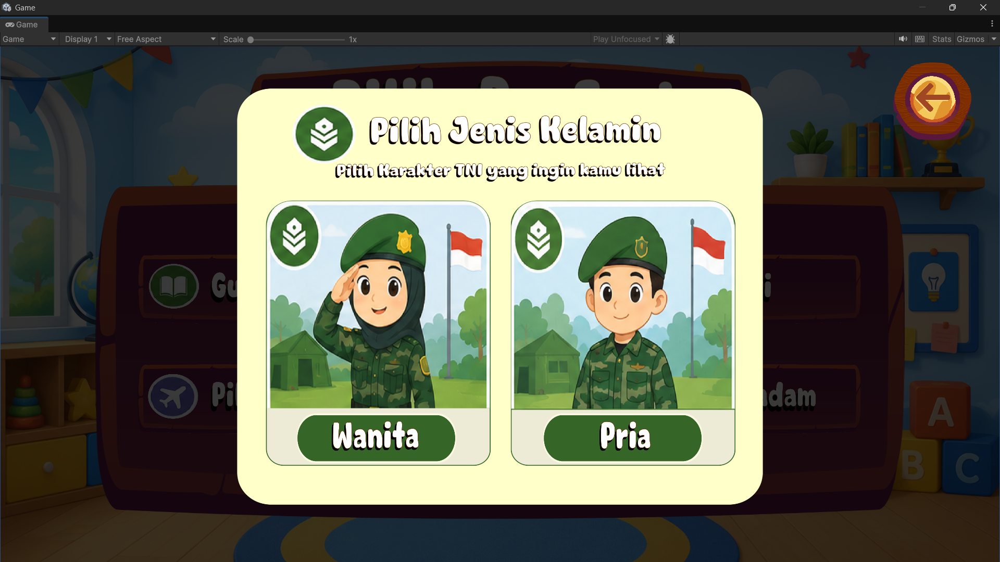
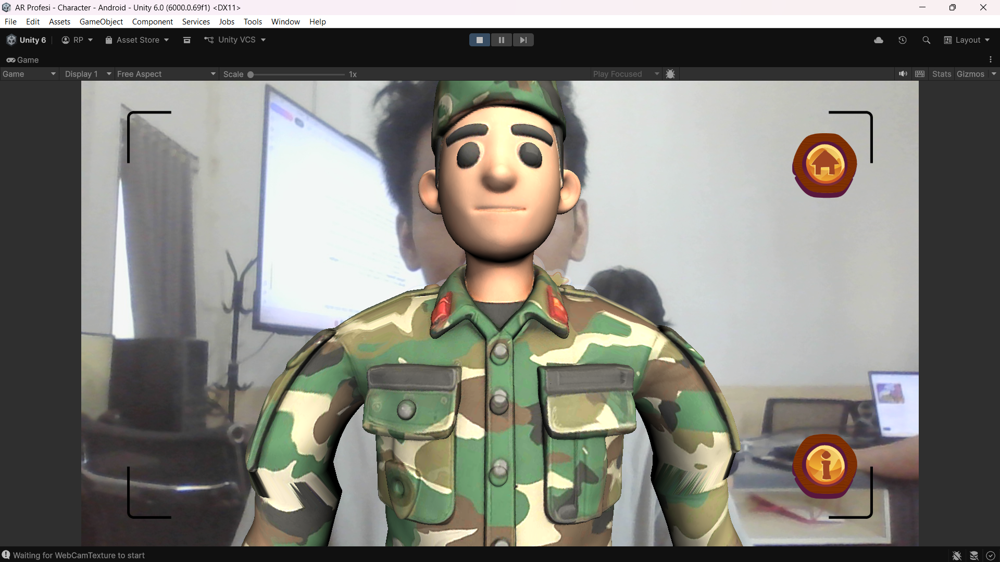
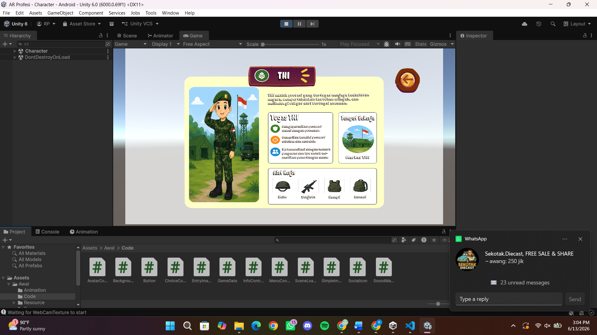

# AR Pengenalan Profesi

Aplikasi **Augmented Reality (AR)** berbasis Unity untuk pengenalan profesi anak usia dini menggunakan **pose detection real-time** melalui kamera perangkat (Smart TV / Android). Aplikasi ini memanfaatkan **MediaPipe Pose Landmarker** untuk mendeteksi gerakan tubuh pengguna dan menampilkan avatar 3D yang mengikuti gerakan secara interaktif.

---

## 📸 Screenshot Aplikasi

Berikut adalah beberapa tampilan dari aplikasi **AR Pengenalan Profesi**:

### 1. Loading Screen
Tampilan awal saat aplikasi memuat scene utama.



> **Keterangan:** Background berwarna biru cerah dengan pemandangan alam, pagar kayu, dan tombol "Loading..." berwarna merah kayu.

---

### 2. Menu Utama (Main Menu)
Tampilan menu utama dengan judul aplikasi, tombol navigasi di sisi kiri, dan hot air balloon di langit.



> **Keterangan:** Menu utama berisi judul "AR PENGENALAN PROFESI" dengan tombol menu (daftar, pengaturan, info, bantuan) di sisi kiri.

---

### 3. Halaman Pengaturan (Settings / Info)
Tampilan penjelasan aplikasi dan tautan media sosial.



> **Keterangan:** Menampilkan penjelasan aplikasi berbasis Augmented Reality dengan pose detection, serta tautan ke WhatsApp, Facebook, Instagram, YouTube, dan TikTok.

---

### 4. Panduan (Tutorial / Guide)
Tampilan panduan langkah-langkah menggunakan aplikasi.



> **Keterangan:** Panduan 5 langkah — Pilih Play AR, Pilih Profesi, Berdiri Depan Kamera, Gerakkan Tubuh, Dengarkan Informasi.

---

### 5. Pilih Profesi (Select Profession)
Tampilan pemilihan profesi yang tersedia dalam aplikasi.



> **Keterangan:** 6 profesi tersedia — Guru, Dokter, Polisi, TNI, Pemadam, Pilot. Setiap profesi memiliki avatar lelaki dan perempuan.

---

### 6. Pilih Jenis Kelamin (Select Gender)
Tampilan pemilihan jenis kelamin sebelum menampilkan avatar.



> **Keterangan:** Pilihan "Wanita" dan "Pria" untuk karakter TNI (atau profesi lain yang dipilih).

---

### 7. AR Feature (Character in AR Mode)
Tampilan karakter TNI yang muncul di real-time melalui kamera perangkat.



> **Keterangan:** Karakter TNI (Tentara Nasional Indonesia) yang menggunakan pose detection untuk mengikuti gerakan tubuh pengguna secara real-time. Karakter ini muncul di tengah layar dengan latar belakang webcam.

---

### 8. Informasi Profesi (TNI Info Panel)
Tampilan detail informasi tentang profesi TNI yang dipilih.



> **Keterangan:** Panel informasi yang menampilkan tugas TNI (mengawal kawasan, melindungi kendaraan perangkat, dan berteman dengan memasang senjata), tempat bekelaj (Marsek TNI), serta alat kegunaan (Kepin, Senjata, Rempit, Remoal).

---

## 🎯 Fitur Aplikasi

| Fitur | Keterangan |
|-------|-----------|
| **Pose Detection Real-Time** | Menggunakan MediaPipe Pose Landmarker untuk mendeteksi titik-titik tubuh (landmarks) secara live melalui kamera. |
| **Avatar 3D Interaktif** | Avatar 3D (pria/wanita) mengikuti gerakan tubuh pengguna secara real-time (tangan, kepala, badan). |
| **6 Profesi** | Guru, Dokter, Polisi, TNI, Pemadam, Pilot — masing-masing dengan avatar pria dan wanita. |
| **Info Panel** | Menampilkan informasi profesi dalam bentuk panel pop-up saat tombol info ditekan. |
| **Audio & Animasi** | Efek suara saat avatar muncul, animasi UI (entry fade/scale), dan pengaturan volume/silent. |
| **Multi Scene** | Loading → Main Menu → Choice Character → Character → Info (dengan navigasi kembali). |

---

## 🏗️ Struktur Folder Proyek (Relevan)

```
Assets/
├── Awal/
│   ├── Animation/          # Animasi loading, menu dropdown, tombol
│   ├── Code/               # Script C# aplikasi
│   │   ├── AvatarController.cs     # Kontrol avatar 3D + pose detection
│   │   ├── ChoiceController.cs     # Pemilihan profesi & jenis kelamin
│   │   ├── InfoController.cs       # Menampilkan info panel per profesi
│   │   ├── MenuController.cs       # Navigasi menu utama & pengaturan volume
│   │   ├── SceneLoader.cs          # Loading screen ke Main Menu
│   │   ├── GameData.cs             # Data statis (JenisKelamin, Jenis_Pekerjaan)
│   │   ├── Button.cs               # Navigasi tombol UI
│   │   ├── EntryImageAnimator.cs   # Animasi UI masuk
│   │   └── ...
│   ├── Resource/
│   │   ├── 3D/            # Model avatar 3D per profesi
│   │   ├── Audio/         # Musik latar / efek suara
│   │   ├── Image/         # Gambar 2D UI, tombol, icon
│   │   └── Texture/       # Texture untuk lingkungan
│   ├── Scenes/
│   │   ├── Loading.unity
│   │   ├── Main Menu.unity
│   │   ├── Choice Character.unity
│   │   └── Character.unity
│   └── TextMesh Pro/      # Font & text rendering
├── MediaPipeUnity/        # Plugin MediaPipe Unity (pose detection)
├── Plugins/               # Plugin native (Android/Windows)
└── StreamingAssets/       # Asset streaming
```

---

## ⚙️ Teknologi & Dependensi

- **Unity Engine** (>= 2022.3)
- **MediaPipe Unity Plugin** (Port C# dari MediaPipe 0.10.22)
- **Pose Landmarker** — untuk mendeteksi titik tubuh (nose, shoulder, arm, leg, dll)
- **AR Foundation / ARCore** — untuk integrasi kamera perangkat
- **UI Toolkit / Unity UI** — untuk tampilan menu, tombol, panel info

---

## 📖 Cara Menggunakan (Dari Screenshot Panduan)

1. **Pilih Play AR** — Masuk ke menu play AR dari halaman utama.
2. **Pilih Profesi** — Pilih profesi yang ingin dipelajari (Guru, Dokter, Polisi, TNI, Pemadam, Pilot).
3. **Berdiri Depan Kamera** — Pastikan tubuh terlihat oleh kamera perangkat.
4. **Gerakkan Tubuh** — Objek 3D akan mengikuti gerakan tubuh secara real-time.
5. **Dengarkan Informasi** — Informasi profesi akan muncul dalam bentuk audio / panel teks.

> **Tips:** Pastikan pencahayaan ruangan cukup agar kamera dapat mendeteksi tubuh dengan baik.

---

## 📂 File Screenshot (Referensi)

Karena screenshot aplikasi diberikan dalam format image, file visual dapat disimpan di folder `docs/images/` untuk disematkan ke README ini. Nama file yang direkomendasikan:

- `screenshot_loading.png` — Loading Screen
- `screenshot_mainmenu.png` — Main Menu
- `screenshot_info.png` — Info / Tentang Aplikasi
- `screenshot_panduan.png` — Panduan
- `screenshot_pilihprofesi.png` — Pilih Profesi
- `screenshot_pilihjk.png` — Pilih Jenis Kelamin
- `screenshot_ar_feature.png` — AR Feature (Karakter TNI di real-time)
- `screenshot_tni_info.png` — Informasi Profesi (TNI Info Panel)

---

## 🔗 Referensi

- **MediaPipe Unity Plugin:** `https://github.com/homuler/MediaPipeUnityPlugin`
- **MediaPipe Pose Landmarker:** Dokumentasi resmi Google MediaPipe
- **Unity AR Foundation:** `https://docs.unity3d.com/Packages/com.unity.xr.arfoundation/` (jika digunakan)

---

*README ini dibuat untuk keperluan dokumentasi GitHub dan tidak mengubah file asli Unity (`Assets/Awal/` dan file `.cs`). Semua screenshot hanya dimasukkan sebagai referensi visual dalam dokumen ini.*
